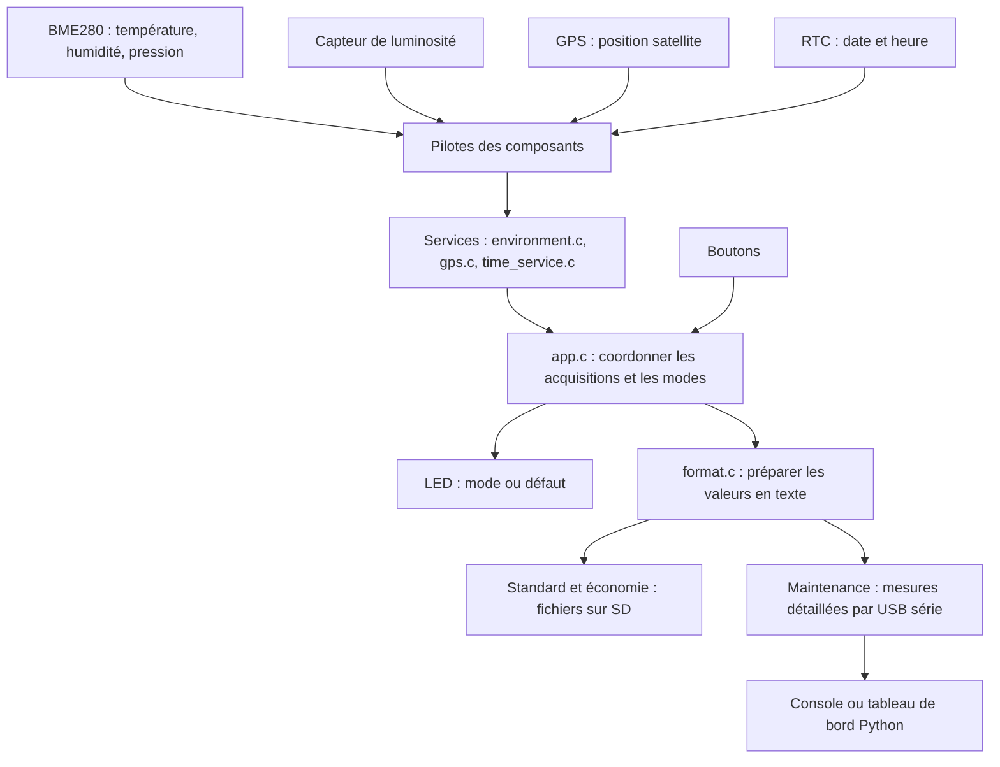

# Comprendre la station météo, du composant à l'affichage

Ce guide explique le fonctionnement du code actuel avec des mots simples.
Les commandes à utiliser pendant la présentation sont dans [SOUTENANCE.md](../SOUTENANCE.md).

**1. Ce que fait la station**

La station mesure son environnement, associe une date aux mesures, puis les
enregistre sur une carte SD ou les transmet au PC selon son mode de fonctionnement.

La Nucleo contient le microcontrôleur STM32 : c'est lui qui exécute le programme C.
Le PC compile et téléverse ce programme, puis peut afficher les données reçues.
Une fois programmée, la station peut fonctionner sans le programme Python,
à condition d'être alimentée et de disposer des composants nécessaires.

Voici le parcours général. Les flèches représentent les échanges et les appels
entre les parties ; toutes les mesures ne passent pas par tous les composants.



**2. Les composants : rôle et raison de leur présence**

| Composant | Ce qu'il fait dans le projet | Pourquoi on l'utilise |
|---|---|---|
| Nucleo-L476RG / STM32 | Exécute les lectures, les commandes et la gestion des modes. | Le programme reste sur la carte et peut fonctionner sans application PC. |
| ST-LINK intégré à la Nucleo | Permet le téléversement et fournit le passage entre l'USB du PC et la console série. | Le même connecteur sert à programmer puis à communiquer avec la station. |
| BME280 VMA335 | Mesure température, humidité relative et pression. | Un seul composant et un seul ensemble de lectures fournissent les trois grandeurs. |
| Capteur de luminosité Grove | Fournit une tension liée à la lumière reçue. | L'entrée analogique du STM32 transforme cette tension en nombre. |
| GPS SIM28 | Fournit des messages contenant notamment une position satellite. | Il permet d'associer les mesures à un lieu. Il n'a pas besoin d'Internet pour obtenir une position. |
| RTC, avec le pilote DS1307 du projet | Fournit la date et l'heure. | Les mesures et les fichiers peuvent être datés même sans position GPS et sans PC. Le maintien de l'heure hors alimentation dépend de la pile et du module. |
| Carte SD et son interface | Conservent les journaux de mesures. | La mémoire est amovible et les fichiers peuvent être relus sur un ordinateur. |
| Deux boutons | Permettent les changements de mode. | Les principales actions restent possibles sans saisir de commande sur un PC. |
| LED RVB Grove P9813 | Affiche une couleur de mode ou un clignotement de défaut. | On voit rapidement l'état de la maquette sans écran ni terminal. |
| Cartes d'extension et connecteurs Grove | Facilitent le raccordement des composants. | Ils organisent le câblage ; ils ne remplacent pas les pilotes logiciels. |

Le BME280 ne mesure pas les gaz : le projet ne présente donc aucune valeur de gaz
comme une vraie mesure. Le fichier BME680 conservé dans la base ne change pas le
composant réellement utilisé par la station.

La luminosité affichée de **0 à 1023** est une valeur relative, **pas une mesure
en lux**. Une conversion en lux demanderait un étalonnage et une relation adaptée
au capteur ; cette conversion n'est pas réalisée ici.

**3. Pourquoi plusieurs types de liaisons ?**

Une liaison est la façon dont deux composants échangent des informations.
Un connecteur Grove peut transporter différentes liaisons : « Grove » désigne
le raccordement, pas un protocole unique.

| Liaison | Utilisation actuelle | Explication simple et raison du choix |
|---|---|---|
| I2C | BME280 et RTC, sur PB8/PB9. | Deux lignes communes : une horloge et les données. Chaque composant possède une adresse, donc ils partagent les mêmes lignes. Le BME280 pourrait aussi utiliser SPI, mais l'I2C permet ici de partager le bus avec la RTC. |
| SPI | Carte SD, sur PA5/PA6/PA7 et sélection PB5. | Les échanges avec la SD passent par une horloge, des lignes de données et un signal de sélection. Ce choix correspond à l'interface SD et au câblage du projet. |
| UART | GPS à 9600 bauds, console à 115200 bauds. | Des caractères sont transmis en série. Le GPS envoie déjà ses messages sous cette forme ; la console utilise une autre UART pour ne pas mélanger les deux flux. |
| ADC | Luminosité sur PA4. | Le convertisseur analogique-numérique transforme une tension en nombre. Ce capteur ne fournit pas directement un message numérique comme le BME280. |
| GPIO | Boutons, sélection SD et commande de la LED. | Une broche lit ou impose un niveau électrique. Le pilote LED fait varier deux broches selon le protocole P9813, distinct de l'I2C. |

Dans le montage actuel, les boutons sont sur PA10/PB3 et la LED sur PB10/PA8.
La console utilise USART2 sur PA2/PA3 via le ST-LINK. Le GPS utilise UART4 sur
PA0/PA1 avec permutation RX/TX configurée pour le câblage actuel.
Les associations exactes sont déclarées dans `include/board_pins.h`.

Le programme configure des broches ; il ne peut pas vérifier à lui seul que les
fils et les alimentations correspondent au montage prévu.

**4. Ce qui se passe au démarrage**

Le démarrage prépare d'abord la mémoire du STM32, puis exécute `main()` dans
`src/main.c`. Ce fichier contient essentiellement trois actions :

```c
Global_Init();
App_Init();
while (1) {
    App_Process(HAL_GetTick());
}
```

Cet extrait reprend la logique du programme ; les fichiers inclus et les
commentaires sont omis pour faciliter la lecture.

`Global_Init()`, dans `setup.c`, prépare les horloges, les broches, l'I2C, le SPI,
les UART et la lecture analogique. Le code configure actuellement le processeur
sur son horloge interne à **16 MHz**. La fréquence maximale indiquée pour une
carte ne signifie pas que le programme utilise forcément cette fréquence.

`App_Init()`, dans `app.c`, prépare la LED, les réglages et les premiers contrôles.
Elle charge les réglages par défaut, puis essaie de les remplacer par ceux
sauvegardés en Flash. Elle choisit le mode initial, initialise le BME280,
vérifie la RTC et tente de monter la SD hors configuration.

Si le bouton rouge est maintenu au démarrage, la station entre en configuration.
Sinon, elle démarre en standard. L'option GPS de démonstration démarre désactivée.

La boucle `while (1)` appelle ensuite continuellement `App_Process()`.
Le programme ne s'arrête pas entre deux acquisitions : il continue de surveiller
les boutons, le GPS, les commandes et la LED.

**5. Comment se déroule une acquisition**

Une acquisition est un ensemble de valeurs collectées pour former un même résultat.

1. `app.c` décide qu'une acquisition doit commencer : échéance atteinte, changement
   de mode ou commande `MEASURE` acceptée.
2. Il prépare une structure `Measurement`. Chaque source possède une valeur et
   un statut. Les anciennes valeurs ne sont pas réutilisées comme des mesures fraîches.
3. Le pilote de luminosité lit l'ADC : valeur brute de 0 à 4095. `app.c` la ramène
   sur l'échelle de 0 à 1023 utilisée dans les sorties du projet.
4. `environment.c` demande au pilote BME280 de lancer une mesure. Le programme
   laisse passer au moins 100 ms en poursuivant les autres traitements, puis lit
   température, humidité et pression. La bibliothèque Bosch utilise les coefficients
   de calibration de la puce pour convertir les données brutes. La pression est
   convertie de pascals en hectopascals.
5. Le GPS est surveillé pendant l'acquisition lorsqu'il est demandé. Le pilote
   attend une phrase GGA valide, reçue depuis le début du cycle et encore récente.
6. Les résultats sont contrôlés : réception réussie, valeurs cohérentes et délais.
7. Quand chaque source a répondu ou épuisé son attente, la RTC fournit la date de
   fin de collecte. Cette date ne correspond donc pas exactement à l'instant de
   lecture de chacun des capteurs.
8. Le résultat est enregistré sur SD ou affiché en détail dans la console selon
   le mode. Les défauts et la LED sont actualisés.

**Pourquoi associer un statut à chaque valeur ?** Une température de zéro degré
est une mesure possible. Zéro ne doit donc pas aussi signifier « capteur absent ».
Le statut distingue une vraie valeur d'une absence, d'une désactivation, d'un
dépassement de délai, d'une incohérence ou du remplacement GPS de démonstration.

**Pourquoi ne pas attendre sans rien faire pendant 15 secondes ?** Une longue
pause empêcherait le programme principal de traiter les boutons et les commandes.
Le superviseur compare des instants en millisecondes et revient régulièrement
dans la boucle. Certaines opérations matérielles restent synchrones et prennent
du temps : le programme n'est pas entièrement asynchrone. Les attentes SD appellent
aussi les services de fond pour entretenir GPS, boutons et LED.

**6. Les quatre modes et les boutons**

| Mode | Comportement principal | LED sans défaut |
|---|---|---|
| Standard | Acquisitions espacées selon `LOG_INTERVAL`, mesures enregistrées sur SD. La console affiche surtout les bilans. | Verte fixe. |
| Configuration | Réglage des paramètres et de la RTC par la console ; acquisitions suspendues. | Jaune fixe. |
| Maintenance | SD libérée ; acquisitions détaillées envoyées vers le PC. Une nouvelle acquisition est programmée une seconde après la fin de la précédente. | Orange fixe. |
| Économique | Intervalle doublé et GPS demandé un cycle sur deux ; mesures enregistrées sur SD. | Bleue fixe. |

En maintenance, une seconde entre deux acquisitions ne signifie pas une mesure
complète chaque seconde. Si le GPS attend 15 secondes, le rythme est d'environ
16 secondes, auxquels s'ajoutent les temps de traitement.

Depuis le standard, un appui rouge de cinq secondes entre en maintenance ; un
nouvel appui rouge après relâchement permet d'en sortir. Un appui vert de cinq
secondes depuis le standard entre en économie. Dans le code actuel, le rouge
depuis l'économie revient d'abord au standard ; il faut relâcher puis refaire un
appui rouge pour entrer en maintenance.

Les boutons sont d'abord filtrés pendant **30 ms** pour ignorer les rebonds du
contact mécanique, puis l'appui doit durer **5 secondes**. Sans filtrage, un seul
appui pourrait produire plusieurs changements électriques très rapprochés.
L'appui long rend également les changements de mode moins accidentels.

Le mode économique limite la fréquence de certaines opérations. Il ne met pas
actuellement le processeur en sommeil profond et ne coupe pas l'alimentation GPS.
Le nom du mode ne constitue donc pas une mesure de la consommation réellement gagnée.

**7. Les fichiers du programme, avec leur rôle**

Les fichiers `.c` contiennent les actions exécutées. Les fichiers `.h`, appelés
en-têtes, déclarent les fonctions, les types et les constantes partagés.
Inclure un `.h` permet à un fichier de connaître une fonction définie ailleurs.
Le compilateur produit des morceaux de programme ; l'éditeur de liens les rassemble.

| Fichier dans `src/` | À quoi il sert | Pourquoi séparer cette partie |
|---|---|---|
| `main.c` | Point d'entrée : initialisation puis boucle de supervision. | Le démarrage reste court et lisible. |
| `setup.c` | Configure le STM32, reçoit et émet les octets UART, expose les accès matériels. Redirige aussi `printf` vers la console. | Les détails des broches et interruptions restent regroupés. |
| `app.c` | Coordonne modes, boutons, commandes, acquisitions, délais, défauts et LED. | Les décisions de fonctionnement restent au même endroit. |
| `environment.c` | Adapte les trois mesures BME280 aux fonctions utilisées par l'application. | `app.c` utilise des valeurs simples sans connaître les structures du pilote. |
| `gps.c` | Adapte le pilote GPS aux types de l'application. | Le superviseur reste indépendant du format interne du pilote. |
| `time_service.c` | Valide le calendrier et traduit les données de la RTC. | Les règles de date sont séparées des échanges électriques I2C. |
| `config.c` | Définit les valeurs par défaut, valide les paramètres et calcule le CRC32. | Contrôler une valeur ne nécessite pas d'accéder à la Flash. |
| `nv_store.c` | Sauvegarde et recharge la configuration en Flash. | La persistance est séparée de la validation des réglages. |
| `format.c` | Transforme une acquisition en huit champs texte séparés par des points-virgules. | Console de maintenance et SD utilisent la même représentation des valeurs. |
| `storage.c` | Choisit le journal du jour, ajoute les mesures et organise les archives. | La politique d'enregistrement reste indépendante du protocole SD. |
| `diskio_spi.c` | Traduit les accès aux secteurs demandés par FatFs en échanges SD sur SPI. | FatFs peut manipuler des fichiers sans connaître les broches STM32. |
| `syscalls.c` | Fournit les adaptations minimales de la bibliothèque C : mémoire, entrée console et services attendus par celle-ci. | Le STM32 n'a pas les services d'un système Linux. La sortie `_write` est, elle, définie dans `setup.c`. |

Exemple concret : `app.c` demande `Env_Read()`. Il n'a pas besoin de savoir quel
registre I2C contient la pression. `environment.c` appelle le pilote Grove, qui
s'appuie sur la bibliothèque Bosch et sur la HAL du STM32.

| Fichier dans `include/` | Rôle |
|---|---|
| `app_types.h` | Structures communes : configuration, acquisition, position, modes et statuts d'erreur. |
| `services.h` | Déclarations des services que les modules utilisent pour communiquer entre eux. |
| `board.h` | Déclarations des accès matériels fournis par `setup.c`. |
| `board_pins.h` | Association des broches et options du montage : couleurs des boutons, polarité, permutation GPS. |
| `setup.h` | Déclaration de `Global_Init()`. |
| `cesi_types.h` | Structures des pilotes provenant de la base pédagogique. Les adaptateurs font le lien avec les types de l'application. |
| `stm32l4xx_hal_conf.h` | Configuration de la bibliothèque matérielle STM32 HAL utilisée à la compilation. |

**8. Les pilotes et les bibliothèques**

Un **pilote** est du code qui sait communiquer avec un composant précis : quels
registres lire, quelles commandes envoyer et comment interpréter les réponses.
Une bibliothèque regroupe du code réutilisable, souvent fourni par un fabricant
ou un autre projet.

| Fichier ou groupe | Rôle dans cette station |
|---|---|
| `lib/cesi_grove/src/grove_bme280.c` | Dialogue I2C avec le BME280, déclenchement des conversions et liaison avec le code Bosch. |
| `lib/bosch_bme280/bme280.c` et ses en-têtes | Lecture des coefficients et calculs de compensation pour obtenir les grandeurs physiques. |
| `lib/cesi_grove/src/grove_light.c` | Configure et lit l'ADC pour la luminosité. |
| `lib/cesi_grove/src/grove_button.c` | Lit l'état électrique des boutons. Le filtrage et les appuis longs restent dans `app.c`. |
| `lib/cesi_grove/src/grove_rgb.c` | Envoie la trame P9813 qui fixe les trois composantes de la couleur. |
| `lib/cesi_grove/src/grove_rtc_ds1307.c` | Lit et écrit les registres de la RTC et convertit leur représentation de la date. |
| `lib/cesi_grove/src/grove_gps_air530z.c` | Configure l'UART GPS, rassemble les messages et valide les phrases GGA. Le nom est hérité ; le module actuel est un SIM28. |
| `lib/cesi_grove/src/sd_logger.c` | Conserve l'initialisation et le diagnostic SD de la base ; son initialisation est utilisée par la couche disque. |
| `lib/cesi_grove/src/sd_logger_file.c` | Ajoute réellement une ligne dans un fichier avec FatFs puis ferme ce fichier. |
| `lib/cesi_grove/src/grove_bme680.c` | Pilote hérité conservé. Le cycle actuel n'utilise pas ce composant pour produire ses mesures. |
| `lib/cesi_grove/include/*.h` | Interfaces publiques des pilotes ci-dessus. |
| `lib/cesi_grove/library.json` | Description de cette bibliothèque pour PlatformIO. |
| `lib/fatfs/ff.c`, `ff.h`, `diskio.h`, `ffconf.h`, `ffunicode.c` | Gestion des fichiers FAT, interface vers les secteurs, configuration et utilitaires associés. |
| HAL et CMSIS installés avec les outils STM32 | Accès aux périphériques et au cœur du STM32. Ce sont des dépendances de compilation, pas des capteurs. |

Les fichiers de licence et de provenance dans `lib/` expliquent l'origine du code
tiers. Ils n'exécutent pas d'action sur la carte.

Pourquoi utiliser le code Bosch et FatFs ? Les calculs de compensation du BME280
et l'organisation d'un système de fichiers demandent beaucoup de détails.
Réutiliser ces bibliothèques permet de concentrer le code du groupe sur le
fonctionnement de la station, tout en conservant des adaptations propres au montage.
Cela ne supprime pas le besoin de tester les échanges sur la vraie maquette.

**9. Les interruptions et les tampons, sans complication**

Les caractères du GPS ou du PC peuvent arriver alors que le programme fait autre
chose. Une **interruption** avertit rapidement le processeur qu'un octet est disponible.

Dans `setup.c`, l'interruption range cet octet dans un **tampon circulaire** :
une petite file d'attente qui revient au début quand elle atteint la fin du tableau.
La boucle principale récupère ensuite les octets pour former des messages complets.
Le projet prévoit un tampon pour la console reçue, un pour le GPS et un pour la
console émise. Chacun dispose ici de 1023 octets utiles.

Pourquoi ne pas analyser le GPS ou écrire sur SD dans l'interruption ? Ces
traitements peuvent être longs. L'interruption doit se terminer rapidement pour
laisser les autres échanges fonctionner. Elle transporte donc les octets ; la
boucle décide de leur signification.

Ces files ont une capacité limitée. `RX_TX_LOST`, malgré son nom, compte plusieurs
types de pertes ou d'erreurs UART, y compris certaines pertes à l'émission.
Une émission demandée ne garantit donc pas que chaque caractère a été affiché
par le PC. Le code choisit de ne pas bloquer indéfiniment la station si la sortie sature.

Il n'y a pas de système d'exploitation de tâches dans le programme embarqué.
Les traitements se partagent une boucle principale, avec des interruptions courtes.
Un système de tâches pourrait être une autre architecture ; il demanderait ici
de gérer davantage de synchronisation et de ressources.

**10. Les trois mémoires à distinguer**

| Mémoire | Ce qu'elle contient | Après extinction |
|---|---|---|
| RAM du STM32 | Mesure en cours, tampons, états, compteurs et option `GPS_DEMO`. | Ces données temporaires sont perdues. |
| Flash du STM32 | Programme compilé et zones réservées aux réglages persistants. | Le programme et les réglages enregistrés restent présents. |
| Carte SD | Journaux des acquisitions enregistrées. | Les fichiers restent sur la carte, sous réserve du bon déroulement des écritures. |

`config.c` propose par défaut un intervalle de 10 minutes, une attente de
30 secondes et une taille de fichier de 2048 octets. Une configuration enregistrée
peut remplacer ces valeurs : **`SHOW` affiche les réglages effectivement utilisés**.
Les valeurs du code par défaut ne suffisent donc pas à connaître l'état de la maquette.

`nv_store.c` garde deux emplacements Flash. Lors d'une sauvegarde, il écrit dans
l'autre emplacement et conserve l'ancien. Chaque enregistrement possède une
version, un numéro de séquence, un CRC et un marqueur de fin.
Au démarrage, le programme choisit la copie valide la plus récente.

Le **CRC** est une empreinte qui permet de détecter des altérations accidentelles.
Le marqueur écrit en dernier aide à reconnaître une sauvegarde complète.
Cette organisation réduit le risque de perdre tous les réglages si une écriture
est interrompue. Une configuration identique n'est pas réécrite inutilement.

`linker.ld` réserve les deux dernières pages Flash pour ces réglages, afin que
le code du programme ne soit pas placé au même endroit.

**11. Comment un fichier apparaît sur la SD**

Il faut distinguer **une carte SD**, qui stocke des secteurs, et **un fichier**,
qui est une organisation de ces données avec un nom et une taille.

Le chemin d'une écriture est le suivant :

```text
app.c : acquisition terminée
  → storage.c : choisir le journal et gérer sa taille
  → format.c : préparer une ligne avec les huit champs
  → sd_logger_file.c : ouvrir, ajouter la ligne, fermer
  → FatFs : organiser les fichiers et leurs emplacements
  → diskio_spi.c : lire et écrire les secteurs
  → SPI : transmettre les octets à la carte SD
```

**FatFs** est une bibliothèque de système de fichiers FAT pour systèmes embarqués.
Elle permet de manipuler des fichiers lisibles sur PC. Écrire directement des
secteurs sans système de fichiers serait possible, mais il faudrait alors un
outil spécifique pour retrouver et interpréter les données.

Le journal courant porte un nom construit avec la date, par exemple
`261021_0.LOG` pour le 21 octobre 2026. Avant qu'un ajout ne dépasse la taille
maximale configurée, `storage.c` prépare une archive de révision, par exemple
`261021_1.LOG`. Il copie puis compare les données avant de réutiliser le fichier
courant. Ce choix privilégie la conservation des mesures déjà enregistrées.

Le fichier est fermé après chaque ligne, ce qui fait synchroniser les données
et métadonnées par FatFs. La maintenance libère le volume pour autoriser le retrait
de la SD. Cela ne rend pas le système invulnérable à une coupure au milieu d'une
écriture : ce n'est pas un système de fichiers journalisé.

Une RTC invalide empêche l'enregistrement dans cette version : le programme
refuse de créer un journal avec une date inventée. Un bilan `SD=ERREUR` peut
donc aussi demander un contrôle de la RTC ; `STATUS` donne le défaut précis.

**12. Console et tableau de bord : deux présentations des échanges série**

Le STM32 prépare les valeurs et les transmet sous forme de texte.
Le moniteur PlatformIO affiche ce texte et permet d'envoyer des commandes.
`cat` lit les textes ; il ne transforme pas les caractères tapés dans son terminal
en commandes série. L'option `--echo` du moniteur affiche localement ce que l'on tape.

Le tableau de bord, dans `tools/station_dashboard.py`, fonctionne sur le PC :

1. `pyserial` ouvre le port série à 115200 bauds.
2. Une tâche de lecture récupère les octets et reconstitue les lignes sans bloquer la fenêtre.
3. Le parseur rassemble les huit champs d'une acquisition complète.
4. Tkinter affiche les valeurs et dessine les courbes avec l'historique reçu.
5. Le bouton d'export enregistre cet historique dans un CSV sur le PC.

La fenêtre conserve jusqu'à 600 acquisitions et demande `STATUS` toutes les cinq
secondes pour actualiser les informations de mode, RTC et défauts. Cette commande
ne déclenche pas une nouvelle mesure.

Les courbes utilisent l'heure de réception sur le PC ; la date envoyée par la RTC
est conservée séparément. Le CSV exporté vient de l'historique du dashboard,
pas d'une lecture automatique des fichiers de la SD. Une reconnexion réinitialise
l'historique affiché. Les données ne sont pas envoyées à un service en ligne.

Pourquoi Python sur le PC et C sur la carte ? Le C sert ici à construire un
programme pour le microcontrôleur et ses périphériques. Python facilite la fenêtre,
la liaison série et l'export sur l'ordinateur. Le Python du dashboard ne tourne
pas sur le STM32 et n'est pas nécessaire pour écrire les mesures sur SD.
Ce sont des choix adaptés au projet ; d'autres langages ou interfaces seraient possibles.

Il faut libérer le port avant de passer d'un lecteur à l'autre. Deux programmes
qui lisent le même flux risquent de se partager les caractères et de recevoir des
blocs incomplets. Un seul lecteur doit donc être utilisé à la fois.

**13. Le GPS de soutenance et les défauts**

Le GPS recherche une position à partir des signaux satellites ; « pas de réseau »
signifie ici qu'il n'a pas encore de position satellite exploitable.
Le programme vérifie notamment le checksum de la phrase, la qualité de position,
les coordonnées et la fraîcheur du message. Une ancienne position n'est pas
automatiquement présentée comme une nouvelle mesure.

Dans le fonctionnement normal, l'absence de position produit `NA` après le délai
configuré. Deux acquisitions demandées en dépassement de délai peuvent déclencher
le défaut GPS. Une donnée incohérente est signalée selon son propre statut.

La commande `GPS_DEMO=1` active le remplacement pour la présentation :

- Le GPS dispose de 15 secondes par acquisition demandée, indépendamment du
  réglage `TIMEOUT` utilisé pour les autres capteurs.
- Une vraie position reçue avant le remplacement reste prioritaire.
- Sinon, latitude et longitude deviennent `0.000000 (DEMO)`.
- Le statut est `VALUE_SIMULATED`, distinct d'une vraie mesure réussie.
- Seul le défaut GPS et son compteur d'échecs sont effacés. Les défauts RTC, SD
  et autres capteurs restent présents.
- Le GPS est réessayé au prochain cycle qui le demande. Les cycles économiques
  qui ignorent volontairement le GPS conservent `NA`.

Pourquoi écrire « DEMO » ? Une vraie position `0,0` est possible. Sans marqueur,
on ne pourrait pas distinguer une position réelle de la valeur de remplacement.
Les mesures des autres capteurs restent réelles. Dans le CSV du dashboard, une
acquisition contenant ce GPS de remplacement porte la source `SERIE_GPS_DEMO`.

L'option reste en RAM : **RESET ou débranchement la désactive**. Il faut renvoyer
`GPS_DEMO=1` pour la réactiver. Ce choix permet de revenir au fonctionnement GPS
normal au démarrage. Conserver l'option demanderait une autre politique de réglage.
La commande `GPS_DEMO=0` la désactive sans redémarrer.

L'option Python `--demo` est différente : elle simule le tableau de bord complet
sur le PC, sans carte. Elle ne vérifie donc pas les vrais capteurs.

Les défauts sont regroupés dans un **masque de bits** : chaque cause possède
sa propre case binaire. Plusieurs défauts peuvent être mémorisés simultanément.
`ERR=0x00` signifie qu'aucun défaut n'est actuellement signalé par le programme,
sans garantir à lui seul la précision physique des mesures.

| Valeur du défaut | Signification |
|---|---|
| `0x01` | RTC absente ou invalide. |
| `0x02` | GPS indisponible après les échecs pris en compte. |
| `0x04` | Défaut d'accès aux autres capteurs. |
| `0x08` | Mesure incohérente par rapport aux contrôles du programme. |
| `0x10` | Carte SD pleine selon le contrôle effectué. |
| `0x20` | Erreur d'accès à la SD. |

Ces valeurs se combinent : `0x03` correspond par exemple aux défauts RTC et GPS.
La LED ne peut afficher qu'un code à la fois : une priorité choisit le défaut
visible, tandis que `STATUS` conserve le masque complet. Un défaut masque la
couleur du mode ; il ne change pas forcément le mode de fonctionnement.

**14. Les fichiers de préparation, de test et de documentation**

| Fichier ou dossier | À quoi il sert |
|---|---|
| `platformio.ini` | Définit la carte cible, le framework STM32, les options de compilation et le téléversement ST-LINK. |
| `linker.ld` | Répartit le programme et ses données en mémoire et réserve les emplacements des réglages. |
| `build.sh` | Raccourci pour compiler, téléverser, ouvrir la console ou lancer les tests. |
| `scripts/build_direct.py` | Autre chemin de compilation avec le compilateur ARM et le SDK déjà installés. Ce Python prépare un programme C ; il ne devient pas le programme embarqué. |
| `scripts/upload_bin.sh` | Téléverse un binaire fourni avec OpenOCD. |
| `scripts/test_host.sh` | Compile et exécute les tests C sur le PC, notamment avec des délais de 10 et 30 secondes pour le GPS de démonstration. |
| `tests/test_core.c` | Vérifie paramètres, calendrier, CRC, messages GPS et format des mesures. |
| `tests/test_app.c` | Simule les périphériques pour tester les modes, les délais, les défauts et la couleur demandée à la LED. |
| `tests/test_storage.c` | Teste le vrai FatFs sur un disque simulé en RAM : fichiers, archives et erreurs. |
| `tests/mock/board.h`, `tests/app_mock/board.h` | Fournissent les interfaces minimales pour compiler ces tests sans vraie carte. |
| `tools/station_dashboard.py --self-test` | Lance les vérifications intégrées du parseur et des conversions de l'interface PC. |
| `.pio/`, `build/`, `.test-build/` | Résultats de compilation générés par les différents outils. |
| `dist/` | Binaires livrés avec le projet. Une compilation PlatformIO produit sa nouvelle version dans `.pio/build/nucleo_l476rg/`, pas automatiquement dans `dist/`. |
| `SHA256SUMS` | Empreintes servant à contrôler les fichiers auxquels elles correspondent. |
| `.gitignore` | Indique à Git certains fichiers locaux ou générés à ne pas suivre. |
| `.clang-format` | Règles de présentation utilisables par l'outil de formatage du code. |
| `README.md` | Présentation générale du dépôt et liens de prise en main. |
| `LANCEMENT.md` | Commandes détaillées pour installer, compiler, téléverser et afficher. |
| `SOUTENANCE.md` | Fiche courte de commandes pour la présentation. |
| `docs/PRISE_EN_MAIN.md` | Aide au contrôle des composants, du câblage et des modes. |
| `docs/INSTALLATION_VIRTUALBOX.md` | Préparation de la VM, passage de l'USB et interface graphique. |
| `docs/BASE_GITHUB.md`, `UPSTREAM_MANIFEST.json` | Origine de la base pédagogique et suivi des fichiers de référence. |
| `docs/VALIDATION.md` | Rapport daté de vérifications antérieures ; ses limites décrivent les essais de cette date. |
| `docs/schema_*.png`, `docs/schema_*.svg` | Schémas visuels des relations entre les parties du projet. |
| Fichiers `.bak-*` | Copies de sauvegarde locales ; elles ne sont pas des sources `.c` utilisées pour le programme actuel. |

Pourquoi tester sur PC avant la carte ? Les tests reproduisent rapidement les
cas difficiles : GPS absent, date invalide, sauvegarde ou accès SD en erreur.
Ils vérifient la logique sans devoir provoquer chaque panne électrique.
Ils ne vérifient toutefois pas le câblage, les tensions, la précision des capteurs
ou la consommation : les essais matériels restent complémentaires.

**15. Les mots à connaître pour expliquer le projet**

| Mot | Définition simple |
|---|---|
| Microcontrôleur | Circuit qui exécute le programme et commande les périphériques. |
| Micrologiciel, ou firmware | Programme compilé chargé dans la carte. |
| Compilation | Transformation du code source en instructions pour le processeur cible. |
| Téléversement | Écriture du programme compilé dans la mémoire de la carte. |
| Pilote | Code qui sait utiliser un composant précis. |
| HAL | Bibliothèque qui fournit des fonctions d'accès au matériel STM32. |
| Acquisition | Collecte de valeurs pour former un résultat. |
| Conversion / compensation | Passage des données brutes du capteur aux grandeurs exploitables, avec les corrections prévues pour ce capteur. |
| Interruption | Mécanisme qui déclenche brièvement un traitement lorsqu'un événement survient. |
| Tampon | Zone mémoire utilisée pour conserver temporairement des données en attente. |
| Protocole | Règles d'échange entre composants ou programmes. |
| Temporisation / échéance | Durée ou instant utilisé pour décider quand agir. |
| Timeout | Délai maximal d'attente avant de considérer une réponse comme absente. |
| RTC | Horloge fournissant date et heure civiles. |
| FatFs | Bibliothèque qui gère les fichiers FAT sur un support de stockage. |
| Secteur | Bloc de données lu ou écrit sur la SD ; ici, 512 octets. |
| CRC / checksum | Valeur de contrôle servant à détecter des altérations accidentelles de données. |
| NMEA / GGA | Format de messages GPS ; GGA contient notamment position, qualité et nombre de satellites. |
| CSV | Fichier texte contenant des champs séparés, utilisable dans un tableur. |
| Parseur | Partie d'un programme qui reconnaît la structure d'un texte et en extrait les données. |
| Écho local | Affichage par le terminal des caractères que l'utilisateur tape. |

Deux différences sont particulièrement utiles à retenir. `HAL_GetTick()` mesure
un temps écoulé depuis le démarrage pour les délais ; la RTC fournit la date et
l'heure. Le bouton physique RESET redémarre la carte ; la commande texte `RESET`,
acceptée en configuration, restaure les paramètres par défaut enregistrés.

**16. Des réponses simples aux questions de soutenance**

« Pourquoi ne pas tout écrire dans `main.c` ? »

Ce serait possible pour un petit exemple. Ici, séparer le matériel, les décisions,
les capteurs et les fichiers permet de comprendre une partie sans relire tout le
programme et de tester certaines parties indépendamment du STM32.

« Pourquoi une RTC alors qu'un GPS peut aussi fournir une heure ? »

Le code actuel utilise la RTC pour dater les mesures et la GGA pour la position.
La date des journaux reste ainsi disponible quand le GPS ne fournit pas de position.
Utiliser une autre source de temps demanderait de définir et d'implémenter cette politique.

« Pourquoi ne pas attendre le GPS indéfiniment ? »

Une acquisition ne se terminerait jamais en intérieur si la position n'arrivait
pas. Un délai permet de conserver les autres mesures. L'option de soutenance
ajoute un remplacement explicitement marqué, sans inventer les valeurs des autres capteurs.

« Pourquoi la maintenance n'enregistre-t-elle pas les mesures sur SD ? »

Elle libère la SD et privilégie les mesures détaillées sur le PC, notamment pour
contrôler les capteurs et retirer la carte après libération. Standard et économie
assurent l'enregistrement. Ce sont les comportements choisis dans cette version.

« Pourquoi ne pas conserver `GPS_DEMO=1` après une coupure ? »

Cette option a été définie comme temporaire : les réglages ordinaires sont en
Flash, tandis que ce drapeau reste en RAM. Cela évite de continuer une utilisation
normale avec un remplacement GPS activé lors d'une présentation précédente.

« Est-ce que le dashboard calcule les mesures à la place de la carte ? »

Les mesures et leur contrôle sont réalisés sur la carte. Le dashboard reçoit
leurs textes, les organise et les affiche. Son mode `--demo` génère au contraire
des données fictives sur le PC et doit être présenté comme une simulation.

**17. Combien de jours avec la carte SD de 8 Go ?**

La carte possède une capacité annoncée de **8 Go**, soit **8 000 000 000 octets**.
Ce n'est pas forcément son espace libre : le formatage et les fichiers déjà
présents en utilisent une partie. Les calculs ci-dessous supposent une carte
presque vide et un fonctionnement continu, sans nettoyage ni export des journaux.

En **maintenance**, la station n'écrit pas les acquisitions sur la SD : la
présentation des courbes ne remplit donc pas la carte. Le calcul concerne le
**mode standard**, qui enregistre les mesures.

Les derniers réglages lus sur la maquette étaient `LOG_INTERVAL=1` et
`FILE_MAX_SIZE=512`. Les confirmer avec `SHOW` avant de reprendre ces chiffres :
une mesure par minute et des fichiers limités à 512 octets. Ce sont des réglages
chargés en Flash ; les valeurs par défaut du code sont différentes.

**La taille d'une mesure enregistrée.** La SD reçoit le format compact de
`format.c`, sans les libellés longs et les unités de la console de maintenance.
Par exemple, avec le GPS de démonstration :

```text
2026-10-21T15:56:46;STANDARD;23.25;44.47;969.97;387;0.000000 (DEMO);0.000000 (DEMO)
```

Cette ligne représente **84 octets**, saut de ligne final compris. Sa longueur
a été vérifiée en exécutant la vraie fonction `Measurement_Format()` sur PC.
Pour les mêmes mesures, avec une position réelle `48.700000;6.200000`, elle
occupe 71 octets ; avec `NA;NA`, 58 octets. Les nombres, les signes et leur nombre
de chiffres font varier la taille : 84 octets est ici un exemple concret, pas
la longueur universelle de toutes les acquisitions.

**Premier calcul : le texte seul.** Avec une mesure par minute :

```text
Mesures par jour = 24 × 60 = 1 440
Texte par jour = 1 440 × 84 = 120 960 octets
Durée théorique = 8 000 000 000 / 120 960 ≈ 66 138 jours
```

Ce résultat ne suffit pas : le système de fichiers réserve de l'espace par
blocs appelés **clusters**, pas octet par octet pour chaque fichier.

**Deuxième calcul : l'espace réellement réservé aux fichiers.** Avec la limite
de 512 octets et des lignes de 84 octets :

```text
Mesures par fichier = partie entière de (512 / 84) = 6
Taille d'un fichier rempli = 6 × 84 = 504 octets
Fichiers produits par jour = 1 440 / 6 = 240
```

`FILE_MAX_SIZE=512` limite chaque fichier courant. Une fois ce fichier rempli,
le programme conserve son contenu dans une archive et continue : ce paramètre
ne signifie pas que toute la carte SD est limitée à 512 octets.

Un fichier de 504 octets occupe au moins un cluster. La taille du cluster dépend
du formatage de la carte ; elle n'a pas été mesurée sur cette SD.

| Hypothèse de formatage | Espace réservé aux fichiers par jour | Durée calculée avec 8 Go |
|---|---|---|
| Clusters de 4 Kio, soit 4 096 octets | 240 × 4 096 = 983 040 octets | Environ **8 138 jours**. |
| Clusters de 32 Kio, soit 32 768 octets | 240 × 32 768 = 7 864 320 octets | Environ **1 017 jours**. |

**Les 1 017 jours ne sont pas la durée globale de fonctionnement à annoncer :**
ce chiffre concerne uniquement la capacité en octets, sous cette hypothèse de
clusters. La limite du répertoire calculée ci-dessous peut arriver bien avant.

Ces durées concernent seulement l'espace des fichiers. Elles ne prennent pas
encore en compte les métadonnées, l'espace déjà occupé et la marge nécessaire
pendant la copie temporaire d'une archive. Le code ne conserve pas deux copies
permanentes de tous les journaux : le fichier courant est réutilisé après
vérification de l'archive.

**La limite du nombre de fichiers intervient avant ces durées.** Tous les
journaux sont actuellement créés dans le même répertoire. La version de FatFs
du projet limite un répertoire FAT à **2 097 152 octets**, avec des entrées de
**32 octets**, soit au plus **65 536 entrées**. Ces constantes se trouvent dans
`lib/fatfs/ff.c` : `MAX_DIR` et `SZDIRE`.

Une entrée sert à décrire un fichier, pas à stocker ses mesures. Un nom long en
utilise plusieurs. Pour un jour complet de l'exemple, les 240 fichiers se nomment
`261021_0.LOG` à `261021_239.LOG`. Avec les noms longs activés dans ce projet :

```text
Révisions 0 à 9     :  10 fichiers × 1 entrée  =  10 entrées
Révisions 10 à 99   :  90 fichiers × 2 entrées = 180 entrées
Révisions 100 à 239 : 140 fichiers × 3 entrées = 420 entrées
Total par jour                               = 610 entrées

Limite approximative du répertoire = 65 536 / 610 ≈ 107 jours
```

Les noms courts respectent le format « huit caractères puis trois caractères
d'extension ». À partir de la révision 10, le nom dépasse ce format. FatFs ajoute
des entrées de nom long, contenant chacune jusqu'à 13 caractères, en plus de
l'entrée de nom court. Le calcul suit celui de `dir_register()` dans `ff.c`.

**Résultat à présenter : dans cet exemple en FAT32, avec une mesure par minute,
des fichiers de 512 octets et des lignes GPS DEMO de 84 octets, l'enregistrement
pourrait se bloquer vers 107 jours à cause du répertoire, alors que les 8 Go
ne seraient pas pleins.** Les 107 jours sont un ordre de grandeur conditionnel,
pas une autonomie matérielle garantie : fichiers existants, tailles variables,
entrées temporaires et formatage modifient cette estimation. En FAT16, la racine
possède une limite fixée par le formatage, potentiellement beaucoup plus petite.

**Pourquoi une estimation proche de 90 jours est-elle aussi possible ?** Deux
caractères de plus par ligne peuvent suffire à changer le nombre de fichiers.
Par exemple, une pression de `1013.25` au lieu de `969.97` et une luminosité de
`1023` au lieu de `387` portent la ligne GPS DEMO de 84 à **86 octets** :

```text
6 × 86 = 516 octets : six mesures ne tiennent plus dans un fichier de 512 octets
5 × 86 = 430 octets : cinq mesures tiennent
Fichiers par jour = 1 440 / 5 = 288
Entrées par jour = 10 × 1 + 90 × 2 + 188 × 3 = 754
Limite approximative du répertoire = 65 536 / 754 ≈ 87 jours
```

Avec des lignes toujours de 86 octets et les autres hypothèses inchangées,
**environ 90 jours** est donc un ordre de grandeur défendable pour atteindre la
limite du répertoire. Ce n'est ni une durée garantie, ni le remplissage des 8 Go,
ni une mesure faite sur la carte actuelle. Avec des tailles de lignes variables,
le nombre réel de fichiers doit être calculé à partir des enregistrements.
Une valeur de 90 jours ne doit donc pas être choisie uniquement parce qu'elle
était attendue : elle doit être accompagnée de ces hypothèses.

Avec les lignes GPS réelles de 71 octets de l'exemple, on obtient 7 mesures par
fichier, environ 206 fichiers et 508 entrées par jour : la même estimation donne
environ **129 jours** avant la limite de répertoire. Cela illustre pourquoi il
faut préciser les hypothèses plutôt qu'annoncer un nombre de jours unique.

Une limite de création de fichier peut être signalée comme une erreur d'accès
SD (`0x20`) même s'il reste de l'espace : le code ne signale « SD pleine »
(`0x10`) que lorsqu'il confirme l'absence de clusters libres.
Ce point est identifié dans le calcul ; aucun changement du programme n'a été fait.

**Pour adapter le calcul à d'autres réglages :**

```text
I = intervalle en minutes ; L = octets par ligne ; M = taille maximale d'un fichier
K = octets par cluster ; F = octets réellement libres

Mesures/jour = 1 440 / I
Mesures/fichier = arrondi inférieur de (M / L)
Fichiers/jour = arrondi supérieur de (mesures/jour / mesures/fichier)
Octets réservés/jour ≈ fichiers/jour × arrondi supérieur de (taille fichier / K) × K
Jours selon l'espace ≈ F / octets réservés par jour
```

Cette approximation suppose des lignes de taille constante et des acquisitions
qui terminent avant l'échéance suivante. Il faut ajouter les métadonnées et
vérifier séparément les limites de répertoire. La maintenance et les mesures
supplémentaires déclenchées manuellement changent le nombre d'enregistrements.
Le mode économique double l'intervalle et ignore le GPS un cycle sur deux :
son calcul doit également tenir compte de ces lignes de tailles différentes.

Pour obtenir la durée propre à la carte actuelle, relever l'espace libre, le
type de FAT et la taille des clusters avec un lecteur de carte sur PC, puis
utiliser les réglages affichés par `SHOW`. Le port USB du ST-LINK est une console
et ne donne pas directement accès à la SD raccordée en SPI.
